# 篮球经纪公司 | Basketball Agency

**从发现一名年轻球员开始，经营一家篮球经纪公司。**

球探报告里有一个值得关注的新人，但他的成长并没有保证。签下他之后，你要决定投入多少训练、帮助他争取什么样的球队角色、是否参加选秀，以及如何在球员利益与公司生存之间取得平衡。

**Build a basketball agency, one career at a time.** Discover prospects, negotiate representation and team contracts, prepare clients for the draft, and manage the business around their careers. The most promising player is not automatically the safest investment; every decision has a cost, a context, and an uncertain outcome.

> 这是项目作品集，展示原游戏的设计与迭代；仓库不包含完整游戏源码、生产服务、原始资产或玩家存档。仓库里的交互演示是使用虚构数据单独制作的设计样本，不代表完整游戏。  
> This is a portfolio about the original game, not its complete source repository. The interactive demo is a separate design sample with fictional data; full game code, production services, original assets, and player saves are not included.

## 体验与展示 | Demo and walkthrough

[打开演示文件 / View the interactive demo](demo/index.html) · 下载仓库后用浏览器打开该文件 / Download the repository and open the file in a browser.

演示可离线运行，包含办公室、球探与潜力、合同报价、选秀、训练和财务六个展示场景，并支持中文与英文切换。它用部分互动展示设计思路，**不是完整游戏或以下全部系统的可玩版本**。

The offline demo has six showcase scenes: office, scouting and potential, contract offers, draft, training, and finance, with Chinese and English language options. These limited interactions illustrate the design; **they are not the full game or a playable implementation of every system described below**.

## 系统画面 | System gallery

以下为独立演示截图，不是原游戏实机截图；所有人物、球队和数字均为虚构。每个场景均提供中文与英文画面。

These are screenshots of the standalone showcase, not screenshots of the original game. All people, teams, and numbers are fictional. Each scene is shown in Chinese and English.

| 场景 / Scene | 中文 | English |
|---|---|---|
| 办公室 / Office | 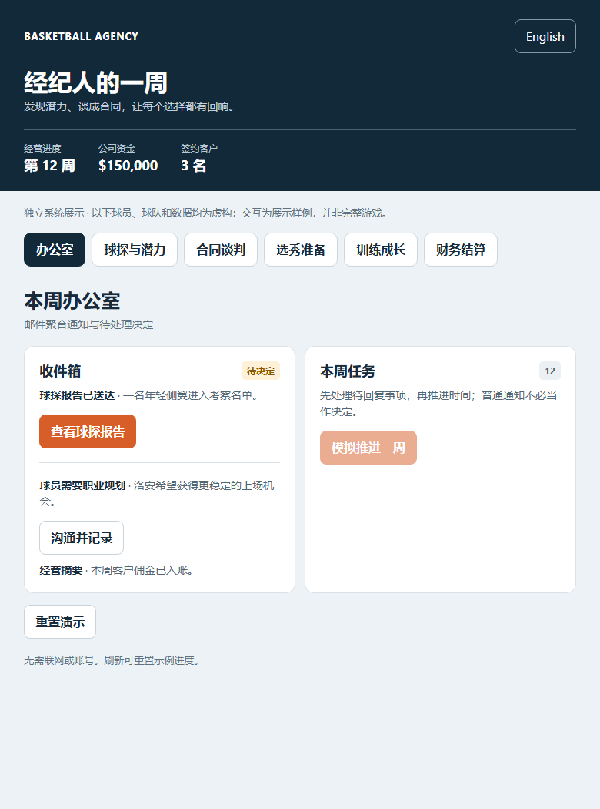 | 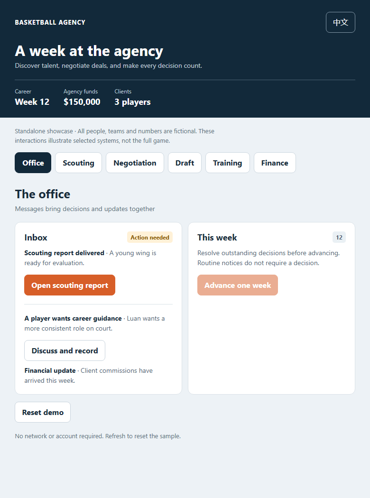 |
| 球探与潜力 / Scouting & potential | 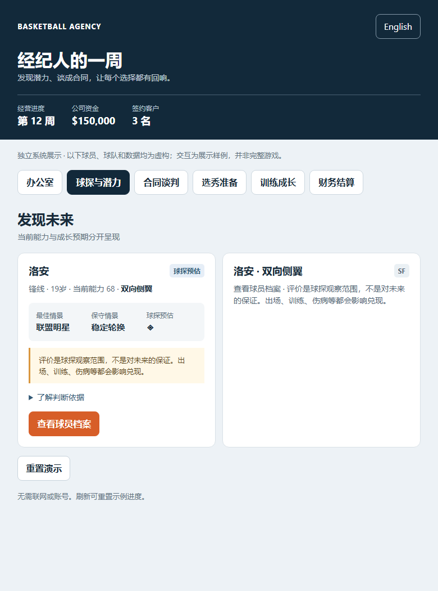 | 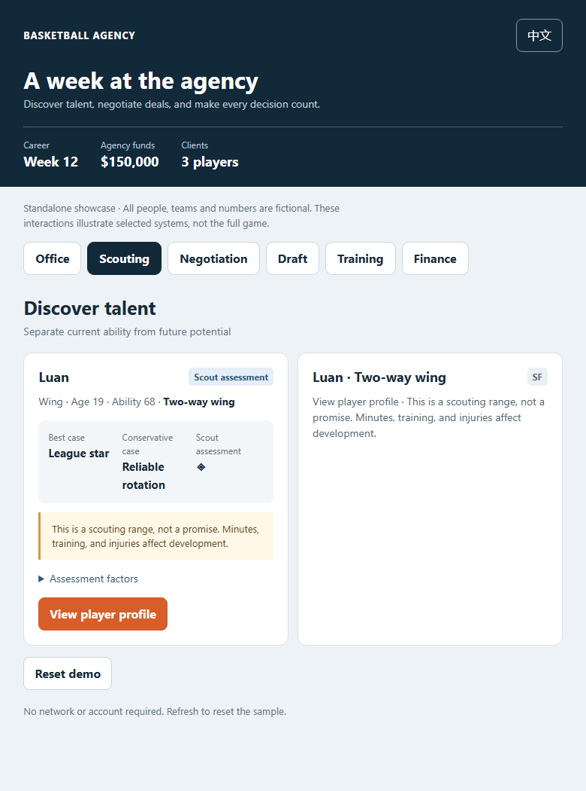 |
| 合同报价 / Contract offers | 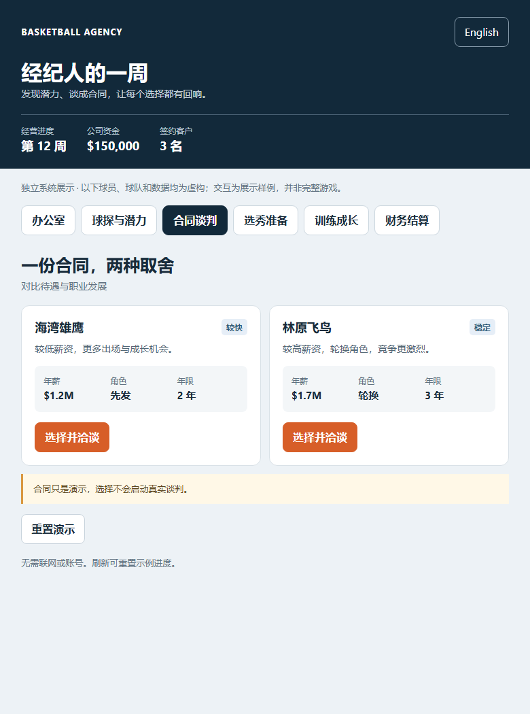 | 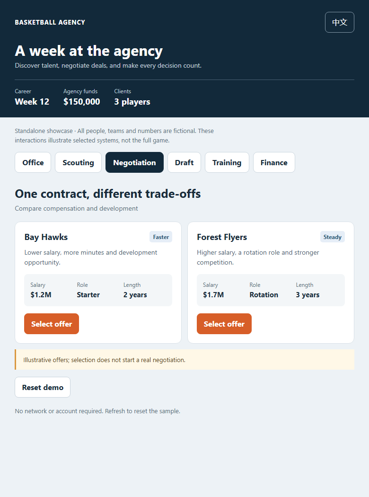 |
| 选秀 / Draft | 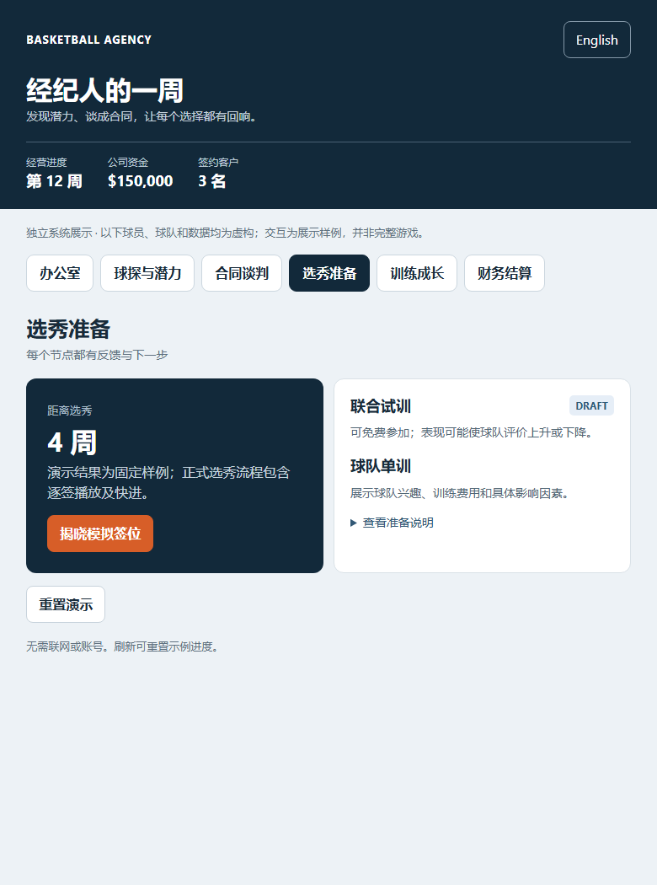 | 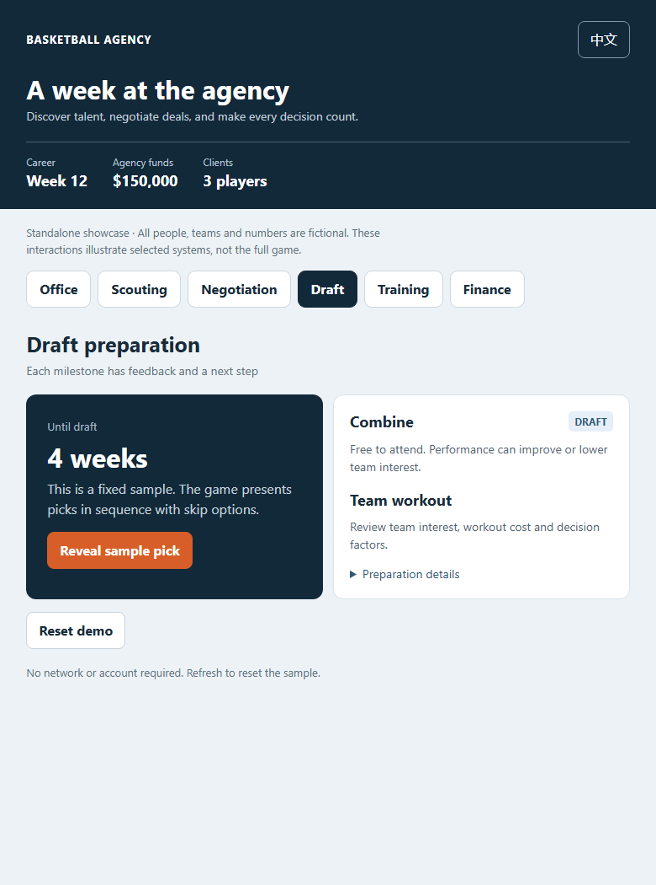 |
| 训练 / Training | 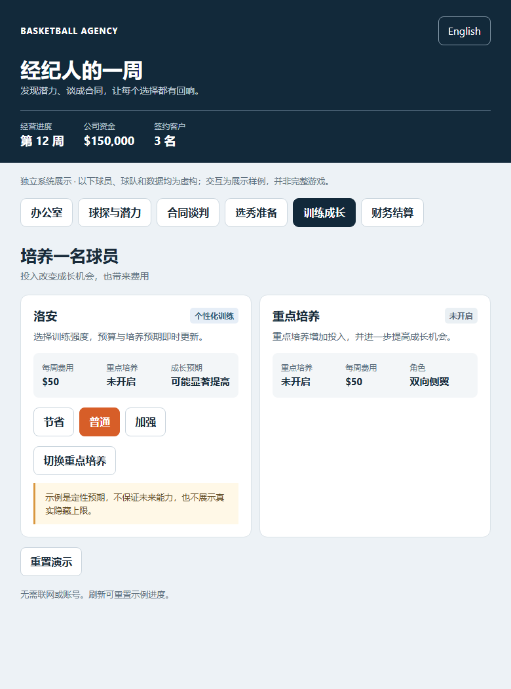 | 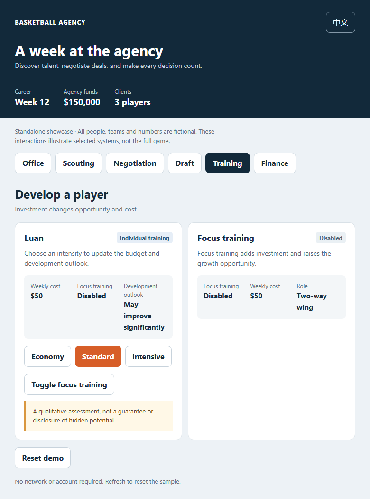 |
| 财务 / Finance | 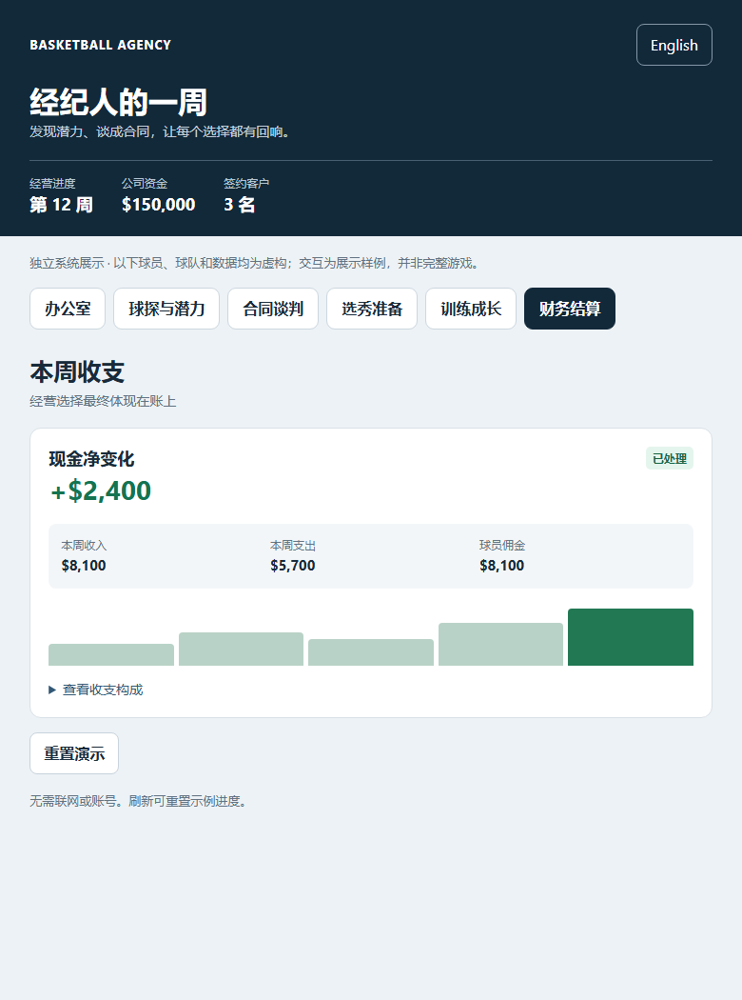 | 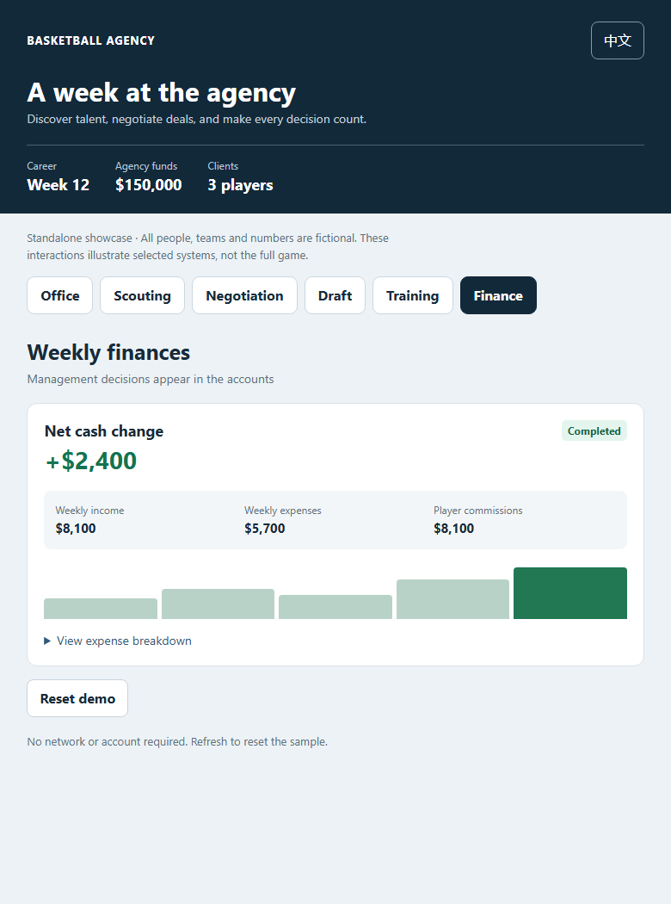 |

## 一家经纪公司如何运转 | The agency loop

```text
球探发现 → 评估与签约 → 培养和寻找机会 → 合同 / 选秀 / 商业合作
    ↑                                                   ↓
    └────────  收益、风险、球员成长与新一周  ←────────┘
```

The game connects scouting, representation, development, contracts, the draft, and agency finances in a repeating weekly loop. A player’s career is not a single transaction: a signed client can later face an injury, seek a better role, approach contract expiry, receive a commercial offer, or draw the attention of another agency.

### 发现球员：一份报告，而不是一个随机数字

不同球探渠道带来不同来源和潜力分布的年轻球员。报告让玩家先查看位置、年龄、当前能力和发展评价，再决定查看档案、接洽签约或暂不考虑。渠道、公司资源和签约条件共同影响选择；稀有潜力不等于即时战力，更不保证签约成功。

Scouting channels produce prospects with different origins and potential distributions. Reports surface the essentials first—position, age, current ability, and development assessment—then let the player inspect, approach, or pass. A rare prospect is not automatically ready to contribute, nor guaranteed to sign.

### 潜力与类型：描述方向，保留不确定性

球员的**当前能力**和**成长空间**分开表达。球探报告用最佳与保守模板展示评估区间，提醒玩家这是一种判断，而不是对未来表现的承诺。模板随位置和打法区分：从组织核心、无球射手到空间内线、护框中锋，球员不仅是一个能力数字。

Current ability and future development are distinct. Best-case and conservative comparisons express a scouting range, not a promise. Position-specific styles—from playmaking guards and off-ball shooters to floor-spacing forwards and rim-protecting centers—give the assessment a basketball identity. As more information becomes available, the displayed range can narrow.

### 合同与谈判：薪资只是决定的一部分

签约代理、协商球队合同、处理续约与解约是相互关联、又彼此独立的过程。比较报价时，年薪、年限和球队角色形成取舍；更高的价格不一定意味着更好的出场机会或发展环境。谈判结果具有不确定性，选择前可查看条款和判断依据；代理合同变化也不应被误认为自动更改球队合同。

Representation, team contracts, renewal, and termination are related but distinct. Comparing offers means weighing salary and duration against role and development opportunities. Negotiation has uncertainty: a better request can be rejected, and ending representation is not the same as terminating a player’s team contract.

### 选秀：从准备到被叫到名字的时刻

每位符合条件的客户都需要决定是否参选；随后可以参加联合试训、安排球队单训并等待反馈。试训可能改变球队的关注，并不保证被选中。选秀夜逐签揭晓，重要客户的时刻放慢，同时提供暂停与快进；落选之后仍有其他职业机会。

Each eligible client makes a draft-entry decision. Combine appearances and individual workouts can generate feedback without guaranteeing selection. Draft night presents picks sequentially, slows down for key client moments, and provides pause and fast-forward controls. An undrafted player’s career can continue through other professional opportunities.

### 培养、关系与经营

训练可以统一设置，也可以按球员单独调整投入与重点培养。年龄、伤病、成长节奏与比赛环境影响培养判断；球员的诉求和场外事件则让经纪关系需要持续维护。公司有现金流、训练与服务开支、团队和个人技能升级，也能寻求商业合作——投资可能带来机会，接洽失败仍有成本。

Training can be set as a general plan and adjusted for individual clients, including a limited focus allocation. Age, injury, growth trajectory, and playing environment inform development. Off-court events and player demands require ongoing relationship management, while staffing, training, services, and commercial outreach create financial trade-offs.

## 邮箱驱动的移动端体验 | An inbox-led mobile experience

邮箱是整个经营流程的入口：球探报告、报价、试训反馈、伤病、续约提醒和商业回复，以消息与可执行的决定进入玩家视野。**未读**和**待回复**是两种不同状态；打开邮件不等于已经作出选择。主页和办公室展示经营摘要、待处理数量和下一步，常用操作围绕稳定导航组织。

The inbox brings scouting, offers, workout results, injuries, renewals, and business replies into one place. **Unread** and **action required** are separate states: opening a message does not complete a decision. The home and office screens summarize the business, outstanding items, and the next action.

移动界面的设计目标是**简洁首屏，周密详情**：列表先展示对象、关键数字和下一步；需要时再展开背景、条款、风险与判断依据。结果中的变化通过文字、颜色或方向标记突出，避免让重要信息淹没在长段落里。报价、球员档案、训练设置和邮件反馈经历了多轮布局与文案调整。

The mobile design emphasizes **concise summaries and useful detail**. Lists prioritize the subject, key figures, and next action; context, terms, risks, and decision factors are available on demand. Result messages highlight changes rather than burying them in paragraphs. Offer comparisons, player profiles, training controls, and feedback screens were repeatedly refined.

## 项目中的关键取舍 | Design and engineering decisions

| 问题 / Problem | 设计方向 / Approach |
|---|---|
| 球员潜力很重要，但不应成为确定的未来 / Potential matters, but should not be a guaranteed future | 用区间和模板呈现判断，区分当下能力与可能的成长 / Show assessment ranges and separate current ability from possible growth. |
| 经营事项多，玩家容易遗漏 / Many concurrent decisions are easy to miss | 以邮箱汇聚消息，独立标识未读、待回复和已完成 / Bring matters into an inbox and distinguish unread, pending, and completed. |
| 长期经营需要结果与风险 / Long-term decisions need consequences | 报价、训练和服务有不同成本与收益；对不确定的结果避免承诺 / Give offers, training, and services distinct trade-offs without promising outcomes. |
| 选秀要有仪式感，又不能让玩家一直等待 / Draft presentation must respect players’ time | 逐签揭晓并允许快进，重要客户的时刻获得更多展示 / Reveal picks sequentially, allow fast-forward, and emphasize clients’ moments. |
| 小屏需要信息密度，但不能挤成一团 / Mobile screens must remain compact and readable | 压缩摘要、统一按钮、详情分组展开 / Keep summaries compact, controls consistent, and detail grouped. |
| 存档与重复操作错误会破坏长期进度 / Save and repeat-action failures can damage a long career | 对提交、重复操作和恢复路径进行排查与定向测试；仍需真实网络与设备验证 / Investigate and test submission, repeat actions, and recovery; real-network and device verification remains necessary. |

## 反馈与迭代 | Iteration from feedback

开发期间的玩家反馈包括：首页入口过大、球员选择按钮冗余、报价信息堆叠、详情重复、部分界面触控不便，以及同步等待和个别事项卡住。迭代方向包括压缩首页、统一操作样式、让报价摘要与详情承担不同职责、突出邮件结论，并针对具体同步与决策路径做排查。

Player feedback included oversized home controls, redundant player-selection buttons, crowded offers, repeated detail text, mobile interaction issues, synchronization waits, and some blocked decisions. Iterations focused on compact navigation, consistent controls, distinct summary and detail views, clearer message outcomes, and investigation of specific synchronization and decision paths.

本地逻辑测试、历史接口检查和用户反馈分别反映不同范围；它们不能互相替代。尤其存档与同步属于持续关注的问题，本作品集不声称所有网络、设备或历史问题都已彻底解决。

Local tests, historical service checks, and player reports each cover different evidence. They are not interchangeable. Saving and synchronization remain important areas of scrutiny; this portfolio does not claim that every network, device, or historical issue has been resolved.

## 我的角色 | My role

我主导游戏构想、经营与交互需求、视觉方向、体验反馈和迭代取舍；开发过程中使用 AI 辅助代码实现、问题排查与测试。这里展示的是产品设计、系统思考和实际迭代，而不声称每一行代码都由本人手写。

I led the game concept, management and interaction requirements, visual direction, feedback, and iteration decisions. AI assisted with implementation, investigation, and testing. This portfolio presents product design, systems thinking, and iteration; it does not claim that every line of code was written by hand.

## 公开范围 | Repository scope

- `demo/` 是独立的六场景交互示例，使用虚构数据；完整游戏玩法和生产系统不在仓库中。
- `screenshots/` 是独立演示的中英文截图，不是原游戏实机画面。
- `demo/` is a six-scene independent interaction sample using fictional data. Full gameplay and production systems are not part of this repository.
- `screenshots/` contains bilingual images of the standalone showcase, not the original game.

除非另有明确许可，本仓库内容仅供查看展示；公开访问并不等于授予复用权。  
Unless otherwise expressly licensed, the contents are provided for viewing as a portfolio; public access does not itself grant permission to reuse them.
