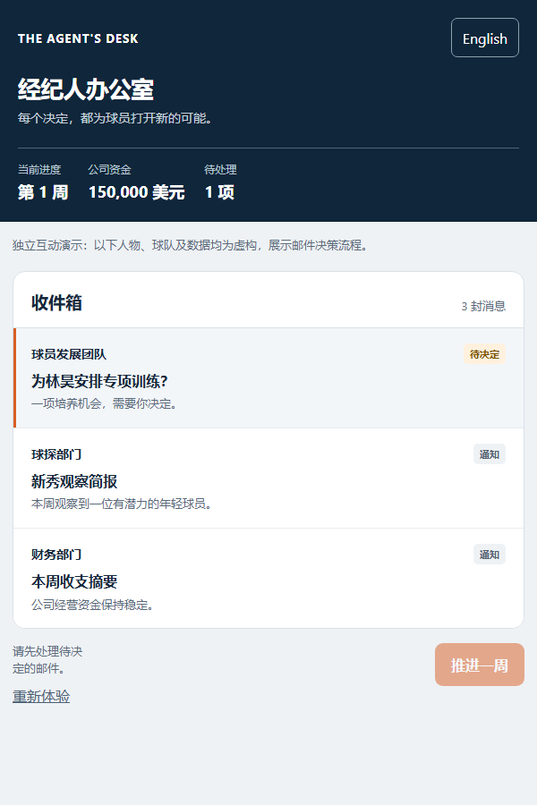

# 篮球经纪公司 · Basketball Agency

一款以邮件决策为核心的篮球经纪经营游戏。玩家发掘年轻球员、洽谈代理与球队合同、安排选秀准备，在长期的不确定性中经营一家经纪公司。

An agent-management game built around an inbox: discover young players, negotiate representation and team contracts, prepare for the draft, and guide an agency through uncertain decisions over time.

> 这是项目作品集，不是完整游戏源码仓库。仓库中的互动演示使用虚构数据，独立呈现设计思路，不代表完整游戏或真实赛季结果。  
> This repository is a project portfolio, not the full game. The interactive demo uses fictional data to illustrate the design; it is not the complete game.

## 互动演示 · Interactive demo

[查看演示文件 / View demo files](demo/index.html)

下载仓库后，在浏览器中打开 `demo/index.html` 即可体验。演示聚焦邮件、信息层级和决策反馈；它不需要账号或服务器。

Download the repository and open `demo/index.html` in a browser. The demo focuses on the inbox, information hierarchy, and decision feedback; no account or server is required.

截图为独立演示画面，使用虚构数据，并非完整游戏截图。  
This screenshot shows the standalone demo with fictional data, not the full game.

## 核心设计 · Design highlights

### 用邮件组织经营 / An inbox for decisions

球探报告、合同机会、球员诉求和选秀反馈通过邮件进入玩家视野。未读和待处理是两个独立状态：查看消息不等于完成决定。操作入口会根据当前事项引导玩家进入下一封邮件、处理待办或推进时间。

Scouting reports, contract opportunities, player requests, and draft updates arrive as messages. Unread and pending decisions are separate states: reading a message does not resolve it. The primary action guides players toward the next message, decision, or time advance.

### 把潜力表达成判断 / Potential as an assessment

当前能力和成长潜力分开呈现。球探报告以最佳与保守模板构成评价范围，帮助玩家理解可能的发展方向，同时提醒这是一种判断，而非球员未来表现的保证。

Current ability and future potential are presented separately. Best-case and conservative comparisons give players a range of possible outcomes while making clear that scouting is an assessment, not a promise.

### 让选秀兼顾节奏与仪式感 / Draft pacing and anticipation

从参选、试训反馈到选秀夜揭晓，球员的经历逐步展开。选秀动画依次呈现签位，也允许玩家快进，让重要时刻有存在感，而不要求玩家等待每一幕。

The journey unfolds through draft entry, workouts, feedback, and draft-night reveals. Picks are presented in sequence with a fast-forward option, balancing anticipation with the player's time.

### 简洁首屏，周密详情 / Concise summaries, useful detail

移动端优先展示对象、关键数字和下一步操作；背景、条款与风险再按需展开。邮件结果突出变化，报价页面把比较重点放在薪资、年限和角色上，减少重复说明。

Mobile screens prioritize the subject, the numbers that matter, and the next action. Context, terms, and risks are available on demand. Message outcomes emphasize what changed, while offer summaries focus on salary, length, and role.

## 开发与迭代 · Development and iteration

项目围绕移动端经营流程持续调整。早期反馈涉及按钮过大、信息拥挤、详情重复、同步等待以及部分事项处理后状态不清楚。迭代工作包括压缩首页卡片、统一按钮与报价展示、区分邮件状态，以及对存档和重复操作问题进行排查与定向测试。

Player feedback shaped the mobile experience. Reported issues included oversized controls, crowded information, repetitive details, save synchronization waits, and unclear decision states. Iterations focused on compact navigation, consistent controls and offer summaries, clearer message states, and targeted investigation and testing of save and repeated-action behavior.

存档和同步是持续关注的复杂问题：本地测试与曾经的线上接口检查只能证明各自覆盖的场景，不能代替完整的真实设备与网络验证。此仓库不包含线上服务、玩家存档或账户信息。

Saving and synchronization remain complex areas. Local tests and historical service checks cover only their specific scenarios; they do not replace full device and network testing. This repository contains no production service, player saves, or account information.

## 我的工作方式 · How I worked

我主导了游戏设想、玩法与界面要求、体验反馈和迭代方向；开发过程中使用 AI 辅助进行代码实现、排查和测试。这个作品集侧重展示设计决策、问题分析和交互思路，而不是声称所有代码均由本人手写。

I led the game concept, gameplay and interface requirements, experience feedback, and iteration direction. AI assisted with implementation, investigation, and testing. This portfolio highlights product decisions, problem solving, and interaction design rather than claiming that every line of code was written by hand.

## 仓库范围 · Repository scope

- `demo/`：使用虚构数据的独立交互演示 / A standalone interaction demo using fictional data.
- 完整游戏规则、生产系统和原始资产不在此仓库中 / Full gameplay rules, production systems, and original assets are not included.

除非另有明确许可，本仓库内容仅供查看展示；公开访问并不等于授予复用权。  
Unless otherwise expressly licensed, the contents are provided for viewing as a portfolio; public access does not itself grant permission to reuse them.
